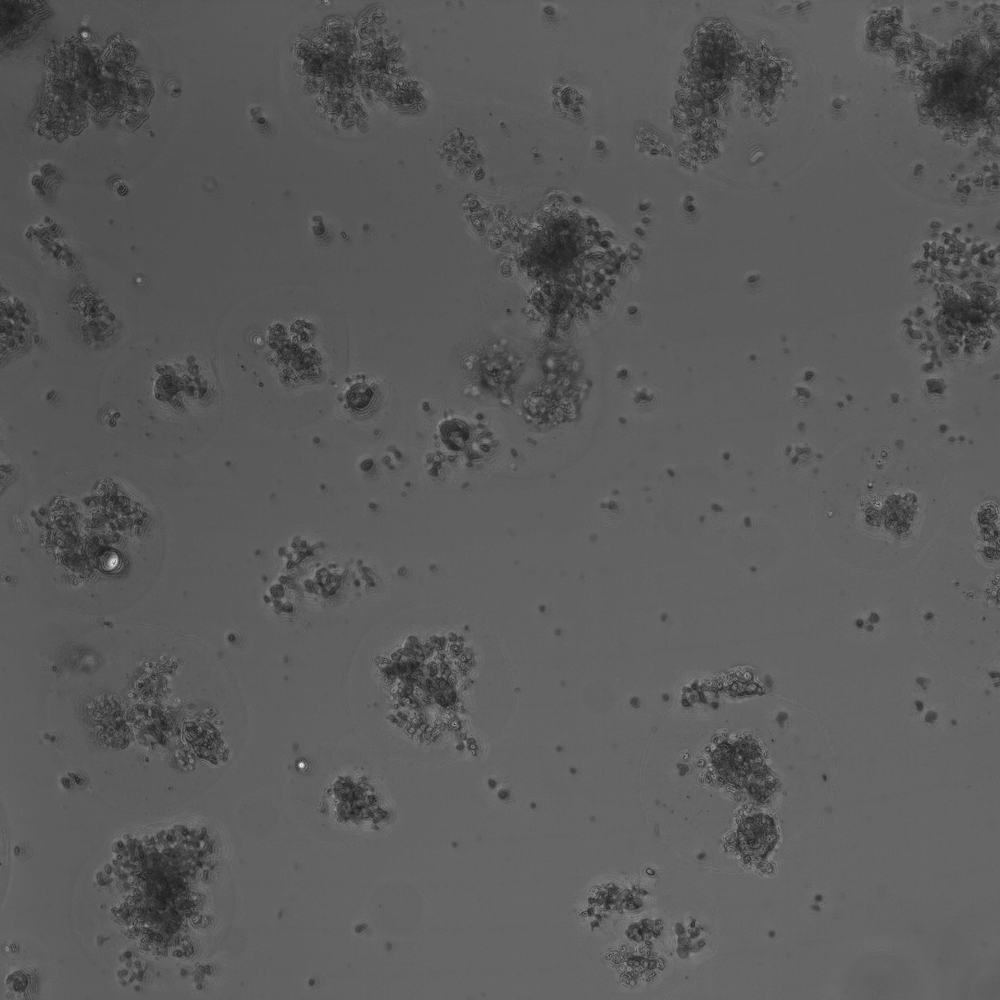

<h1 align="center">Morphi</h1>

  A computational framework for organoid multi-dimensions analysis. 

  <strong>Official implementation of “AI-driven phenotypic profiling of organoids in droplet culture”</strong>

  
  
  <!--  -->

<h2>Overview</h2>

<ul>
  <li><strong>Z-stack projection</strong></li>
  <li><strong>Fluorescent-signal capture</strong></li>
  <li><strong>DoANet</strong>: pixel-level prediction of live/dead regions.</li>
  <li><strong>Instance segmentation</strong>: organoid/generalized object detection.</li>
  <li><strong>Death-rate analysis</strong>: combines semantic and instance masks to calculate the death rate of each organoid.</li>
  <li><strong>Feature extraction</strong>: instance-level morphological and texture features are extracted.</li>
</ul>

<pre><code>Morphi/
├── Z-stack_projection/     # multi-layer projection
├── Edge-detection/         # fluorescence detection
├── DoANet/                 # viability analysis
└── Instance-segment/       # organoid instance segmentation
    └── Feature_analysis/   # feature extraction and cluster
</code></pre>

<h2>Installation</h2>

<pre><code>git clone https://github.com/JinLab-Westlake/Morphi-models.git
cd Morphi-models

chmod +x install.sh
bash install.sh

conda activate morphi
</code></pre>

<h2>Model Checkpoints</h2>

Download the pretrained checkpoints and place them under:

<pre><code>Morphi/
└──checkpoints/
    ├── doanet/
    │   └── DoA.pth
    └── instance/
        └── Organoid-seg.pth
</code></pre>

Download:

<pre><code>&lt;MODEL_CHECKPOINT_DOWNLOAD_URL&gt;</code></pre>

<h2>Input</h2>

Morphi accepts bright-field organoid images.

<pre><code>docs/
└──example/
    └── input/
        └── example.png
</code></pre>

DoANet processes full-resolution images using 224 × 224 patches.
Overlapping predictions are averaged before reconstruction of the final
semantic mask.

<h2>Run the Pipeline</h2>

<pre><code>bash scripts/run_full_pipeline.sh</code></pre>

<h2>Output</h2>

<pre><code>Morphi/
└──pipeline_results/
    └── example/
        ├── example_semantic.png
        ├── instance_mask/
        │   └── example_instance_label.tif
        ├── overlay/
        │   └── example.png
        └── instance_death_rate.xlsx
</code></pre>

<table align="center">
  <tr>
    <td align="center">
       
      <b>Input</b>
    </td>
    <td align="center">
       
      <b>Output</b>
    </td>
  </tr>
</table>

Each organoid receives a unique integer ID in the instance mask.
The death-rate table example:

<table>
<tr><th>image_name</th><th>instance_id</th><th>instance_area</th><th>dead_pixels</th><th>death_rate</th></tr>
<tr><td>Image.tiff</td><td>1</td><td>6905</td><td>5955</td><td>86.73</td></tr>
<tr><td>Image.tiff</td><td>2</td><td>1811</td><td>1811</td><td>100</td></tr>
<tr><td>Image.tiff</td><td>3</td><td>2481</td><td>2481</td><td>100</td></tr>
<tr><td>Image.tiff</td><td>...</td><td>...</td><td>...</td><td>...</td></tr>
</table>

<h2>Feature extraction</h2>
<pre><code>cd Morphi/Instance-segment/Feature_analysis
</code></pre>

Usage:

<pre>
<code>python info_extract_instance.py \
    --pairs_csv /path/to/pairs.csv \
    --out_csv   /path/to/features.csv \
    [--out_xlsx /path/to/features.xlsx] \
    [--pixel_size 0.5] \
    [--glcm_dist 1 2] \
    [--glcm_angles 0 0.78539816339 1.57079632679 2.35619449019] \
    [--glcm_levels 64]</code>
</pre>

<h2>Run DoANet Only</h2>
<pre><code>python DoANet/inference_full_image.py \
    --image_path &lt;INPUT_IMAGE&gt; \
    --checkpoint &lt;DOANET_CHECKPOINT&gt; \
    --output_dir &lt;MODEL_OUTPUT_DIRECTORY&gt; \
    --test_save_dir &lt;OUTPUT_DIRECTORY&gt; \
    --cfg &lt;DOANET_CONFIG&gt; \
    --img_size 224 \
    --stride 224 \
    --num_classes 3
</code></pre>

<h2>Reproducibility</h2>

The experimental environment is provided in
<code>Morphi/env/environment.yaml</code>.
The Detectron2 source used for the experiments is bundled in
<code>Morphi/env/detectron2/</code>.

<h2>Citation</h2>

<h2>License</h2>

